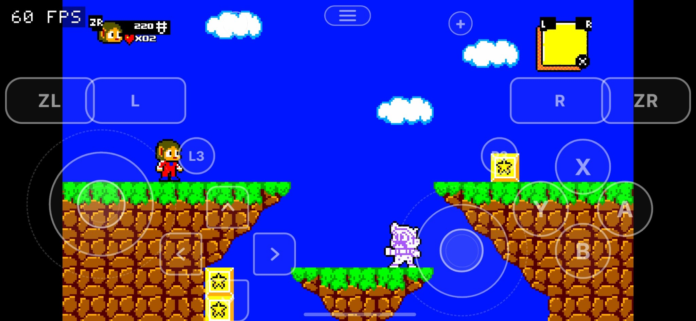
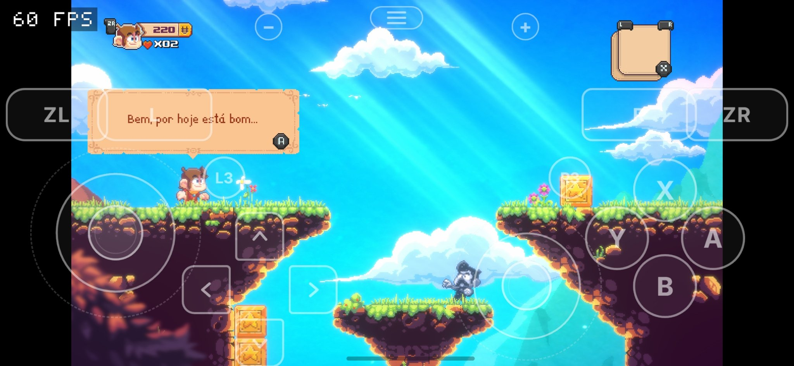
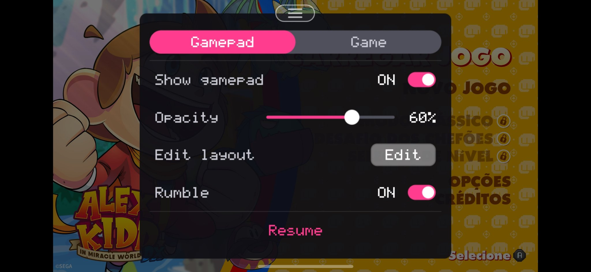
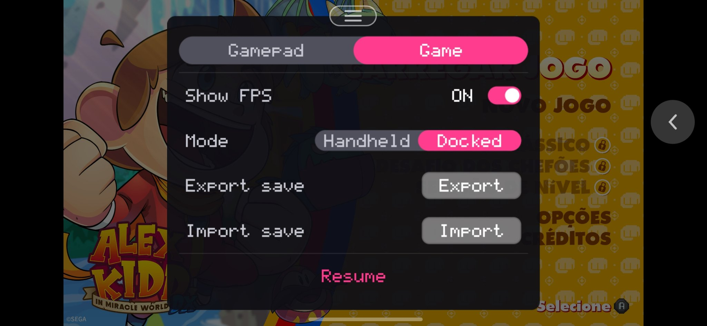
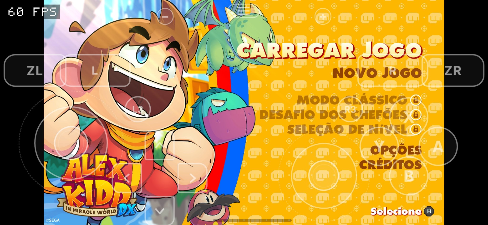

# Alex Kidd in Miracle World DX no Android (nx2android)

Port experimental de **Alex Kidd in Miracle World DX** (Switch) para Android,
feito com o [nx2android](https://github.com/shirai91/nx2android) —
recompilação estática do jogo para rodar nativamente no celular, sem
emulador.

> **Alpha01 — experimental.** O projeto está em fase de desenvolvimento.
> As capturas abaixo provam que o jogo **abre, chega ao menu principal e
> ao início da gameplay a 60 FPS no Galaxy S23**, nos modos retrô e DX.
> **Não é um teste do jogo completo**: nada além do menu e do início da
> gameplay foi testado até aqui. Áreas, chefes e modos posteriores podem
> ter shaders faltando, texturas faltando, loadings presos ou crashes
> ainda não vistos. Baixe sabendo que é um alpha, não uma versão final.

## Download

📦 **[Release launcher-0.1](https://github.com/CowKillers/alex-kidd-in-miracle-world-dx-nx2android/releases/tag/launcher-0.1)**
— arquivo `AlexKiddInMiracleWorldDx-launcher-v16.apk` (7,9 MB, pacote
`org.nx2a.t010025d01221a000`, versionCode 18 / versão do jogo 1.4.0,
única permissão VIBRATE). É o launcher com o jogo dentro — veja
`RELEASE_NOTES-launcher-0.1.md` para o que mudou em relação à alpha02
(saves no launcher e drivers de GPU com Turnip incluso).

APK funcional disponibilizado na release launcher-0.1 — veja o tutorial
abaixo para instalar e colocar os dados do jogo no lugar certo.

## Vídeo

🎬 [Gameplay no Android — Alex Kidd in Miracle World DX](https://youtu.be/NU_LPBY7MpM)

## Capturas (Galaxy S23, 60 FPS)











## Mini tutorial — como instalar

### Requisitos

- Android arm64, com Vulkan 1.2+ e timeline semaphores. Testado e
  funcionando no Galaxy S23 (Adreno 740, Vulkan 1.3), a 60 FPS nas
  capturas acima.
- Controle físico ou touch na tela.

### Passo 1 — Instale o APK

1. Baixe `AlexKiddInMiracleWorldDx-launcher-v16.apk` da
   [release launcher-0.1](https://github.com/CowKillers/alex-kidd-in-miracle-world-dx-nx2android/releases/tag/launcher-0.1).
2. Abra o arquivo no celular e permita "instalar apps desconhecidos"
   quando o Android pedir. O app aparece como
   **Alex Kidd in Miracle World DX**.

### Passo 2 — Coloque os dados do jogo no lugar certo

**Os dados NÃO vêm no APK e NÃO estão neste repositório.** Você precisa
gerar o seu próprio pacote de dados com o porter do nx2android, a partir
do **seu próprio dump do jogo (NSP) e das suas próprias chaves** — nunca
baixe nem compartilhe RomFS, NSP, shaders ou chaves de terceiros.

Depois de gerar o pacote, copie o conteúdo **solto** (sem pasta extra no
meio) para:

```
Android/data/org.nx2a.t010025d01221a000/files/
```

A pasta tem que ficar assim:

```
Android/data/org.nx2a.t010025d01221a000/files/
├── RomFS/
├── mods/
├── shaders.dmsv
├── env.txt
└── nx2a-data.json
```

Detalhes que quebram o jogo se estiverem errados:

- O arquivo de shaders tem que se chamar **exatamente `shaders.dmsv`**,
  na raiz de `files/` — qualquer outro nome é ignorado.
- Não crie uma pasta `AlexKiddInMiracleWorldDx-data` nem `games` no meio
  do caminho.
- Se você desinstalar o app, **o Android apaga essa pasta inteira**
  (dados e saves). Depois de reinstalar, copie os dados de novo.

### Passo 3 — Jogue

Abra o **Alex Kidd in Miracle World DX** e jogue. O log do jogo fica em
`Android/data/org.nx2a.t010025d01221a000/files/log.txt` — pegue esse
arquivo **antes de reabrir o jogo**, porque no boot seguinte ele vira
`log.prev.txt`. Se algo der errado, esse log é o que decide o próximo
passo.

## Hide/Show no editor de layout

Recurso próprio deste port, aplicado pelo patch em `patches/hide.patch`
(veja `patches/README.md`). Todos os botões começam **visíveis** — nada
vem pré-escondido, e quem escolhe o que esconder é você.

1. Abra o menu de pausa (botão de menu) → Gamepad → **Edit layout**.
2. A barra do editor tem `-`, `+`, **Hide**, **Show all**, Reset, Cancel
   e Save.
3. Toque no botão que você quer tirar e aperte **Hide**, depois **Save**:
   ele some do jogo e não responde mais ao toque onde estava.
4. Para trazer de volta: reabra o editor — o botão escondido aparece
   apagado (fantasma). Toque nele e aperte **Hide** de novo (o Hide é um
   toggle), ou aperte **Show all** para trazer todos de uma vez, depois
   **Save**.
5. O botão do menu do pause **nunca pode ser escondido** — sem ele não
   haveria como abrir o pause nem o editor.
6. **Reset** + Save restaura posições, tamanhos e escondidos ao padrão
   (saída de emergência).
7. O escondido persiste em `settings.txt` como
   `hidden=<layout>,<controle>` (por exemplo, `hidden=phone,y`), e é
   **por layout**: esconder no layout phone do celular em paisagem não
   esconde no layout tablet, se a proporção da janela mudar.

## Mini tutorial — como buildar

### Requisitos

- Android arm64 com Vulkan 1.2+ e timeline semaphores (para testar),
  numa GPU que leia texturas comprimidas BC (Adreno, Xclipse — não
  Mali ou PowerVR, segundo o próprio nx2android).
- Android NDK **27.2.12479018**, .NET SDK **10**, Python **3.12**.
- O porter do nx2android, versão **v0.2.0, HEAD `ba7499a`**
  (https://github.com/shirai91/nx2android).
- O seu próprio dump do jogo (NSP) e as suas próprias `prod.keys`.
  **Nunca use a chave de assinatura de terceiros**: um APK assinado com
  outra chave não instala por cima do anterior — exige desinstalação
  limpa, que apaga `files/` e os saves.

### Ferramentas — dois caminhos

**Caminho fácil (sem programar):** baixe o pacote do nx2android da
página de releases do projeto (`nx2android-<versão>-windows-x64.zip`
ou `-macos-arm64.zip`), abra o app, na aba **Setup** clique em
**Download missing tools** (baixa NDK, .NET SDK e platform-tools, ~1 GB)
e configure as suas `prod.keys` — cada linha fica verde. Depois use a
aba **Port** com a pasta do seu NSP. O guia passo a passo do próprio
projeto é `packaging/INSTALL.md` no repositório dele.

**Caminho por linha de comando (o que o resto deste tutorial usa):**
instale você mesmo o NDK 27.2.12479018, o .NET SDK 10 e o Python 3.12,
e rode os comandos a partir da **raiz do clone** do nx2android — o
porter é um módulo do próprio repositório, não precisa de `pip install`
para rodar (`pip install pillow` é opcional: sem ele, o APK sai sem o
ícone do jogo). O `mkapk.py` não precisa de JDK nem de Android SDK:
ele monta e assina o APK só com a biblioteca padrão do Python.

### Chave de assinatura — como ela nasce (e por que guardá-la)

O `mkapk.py` (e o porter) usa um arquivo `signing-key.json` na pasta
do usuário do nx2android (`%APPDATA%\nx2android` no Windows,
`~/Library/Application Support/nx2android` no Mac,
`~/.config/nx2android` no Linux; `NX2A_HOME` sobrescreve). **Na
primeira vez que você empacota um APK, esse arquivo é criado
automaticamente e reutilizado em todos os ports seguintes** — é ele
que faz um APK novo instalar por cima do anterior. Guarde uma cópia
dele em lugar seguro e **nunca o compartilhe nem o suba para nenhum
repositório**: quem perde a chave só consegue instalar o próximo APK
com desinstalação limpa, que apaga `files/` e os saves. Este
repositório não contém nenhuma chave, e a chave usada nas releases
alpha01 e alpha02 não está aqui.

### Passo 1 — Clone o nx2android

```sh
git clone https://github.com/shirai91/nx2android
cd nx2android
```

Confirme que está em `ba7499a` (v0.2.0) antes de continuar.

### Passo 2 — Aplique o patch Hide

```sh
# copie patches/hide.patch deste repositório para dentro do clone e aplique:
cp /caminho/para/alex-kidd-in-miracle-world-dx-nx2android/patches/hide.patch .
git apply hide.patch
git status --porcelain
```

O `git status` deve mostrar **somente** estes 3 arquivos modificados:

```
 M nxnative/dm/android/front_android.c
 M nxnative/dm/android/gfx_vk_present.c
 M nxnative/dm/android/overlay_layout.h
```

Sem o patch, o APK builda normalmente, mas **sem o Hide** no editor.

### Passo 3 — Porte o jogo com o porter (perfil experimental)

Alex Kidd não tem perfil upstream no nx2android: o port é experimental
e o porter gera um perfil provisório a partir do survey do seu NSP.

```sh
# a partir da raiz do clone do nx2android:
python3 -m porter port <pasta-do-seu-jogo> --experimental
```

Use a sua própria pasta com o seu NSP e as suas próprias `prod.keys`
(configuradas com `porter config keys <caminho>`, ou com `-k <caminho>`
no comando). **Onde saem os arquivos (padrão, sem `-o`):** na própria
pasta do jogo — o APK (`AlexKiddInMiracleWorldDx.apk`) e o pacote de
dados (`AlexKiddInMiracleWorldDx-data/`); a pasta de build do port é
`<pasta-do-jogo>/010025D01221A000_build/` (lá dentro ficam `profile/`,
`logs/`, `shader/` e o host). A referência do perfil Android gerado
está em `profiles/android.tsv` deste repositório (veja
`profiles/README.md`). O `game.tsv` do perfil **não** está aqui de
propósito: o porter experimental o regenera a partir do survey do seu
NSP — não edite um `game.tsv` à mão esperando que o port o respeite.

### Passo 4 — (Opcional, para rebuildar só o host) Build + repack

Para rebuildar apenas o host com o Hide, sem refazer o port inteiro,
a partir da raiz do clone do nx2android (com o patch já aplicado):

```sh
DM_GAMES_DIR=<pasta-do-jogo>/010025D01221A000_build/profile DM_GAMES_FIRST=1 \
  python3 nxnative/dm/android/build.py --game 010025D01221A000 \
    --ndk <caminho-do-NDK-27.2.12479018> --out <pasta-de-saída-do-host> \
    --lib --release
```

O `.so` sai em `<pasta-de-saída-do-host>/libdmhost.so`. Depois
reempacote o APK com `nxnative/dm/android/apk/mkapk.py`, usando **o
seu próprio signer** (o `signing-key.json` da seção acima). Exemplo
completo, com o tema ergo (sem os assets do tema, o gamepad desenha
sem tema) e o ícone opcional:

```sh
python3 nxnative/dm/android/apk/mkapk.py \
  <pasta-de-saída-do-host>/libdmhost.so \
  AlexKiddInMiracleWorldDx-hide.apk \
  ~/.config/nx2android/signing-key.json \
  --package org.nx2a.t010025d01221a000 \
  --label "Alex Kidd in Miracle World DX" \
  --lib dmhost --landscape \
  --version-code 3 --version-name 1.4.0 --release \
  --asset overlay/theme.tsv=nxnative/dm/android/themes/ergo/theme.tsv \
  --asset overlay/phone.png=nxnative/dm/android/themes/ergo/phone.png \
  --asset overlay/tablet.png=nxnative/dm/android/themes/ergo/tablet.png
  # --icon <icone-256px.png>  (opcional; sem ele, o ícone padrão do sistema)
```

Regras do versionCode: **tem que ser maior que o do APK já instalado**
para instalar por cima — a launcher-0.1 é versionCode 18, então o próximo
build usa 19 ou mais, com o mesmo pacote e a mesma chave de assinatura.
Confira no APK final: mesmo pacote, mesma assinatura do APK que já
estava instalado, e o `libdmhost.so` novo dentro do APK (o `mkapk.py`
imprime o SHA-256 do signer ao empacotar; com `apksigner verify
--print-certs`, se você tiver o Android SDK, dá para conferir de novo).

### Editar o projeto — o fluxo de trabalho

- **Editar o host (controles, editor, overlay):** mexa em
  `nxnative/dm/android/` — é lá que vivem `front_android.c`,
  `gfx_vk_present.c` e `overlay_layout.h` (o Hide foi todo nesses 3
  arquivos). Depois rode só o Passo 4 acima: rebuild do host +
  repack, instale por cima, **sem refazer o port e sem tocar no data
  pack** — os dados em `files/` continuam lá.
- **Editar o perfil do jogo:** não há um `game.tsv` pronto neste repo
  para copiar — o porter o gera no Passo 3. Se quiser ajustar memória
  ou outro valor do perfil, faça isso no perfil gerado em
  `<pasta-do-jogo>/010025D01221A000_build/profile/` e rebuild o host
  com ele, sabendo que os valores do perfil provisório são palpites
  do survey, não medições de boot.
- **Debugar:** o log do jogo fica em
  `Android/data/org.nx2a.t010025d01221a000/files/log.txt` — pegue
  antes de reabrir o jogo, porque no boot seguinte ele vira
  `log.prev.txt`. Mudança de comportamento sem mudança no log é
  hipótese, não prova.

## Estado atual

- O jogo abre, chega ao menu principal e ao início da gameplay a
  60 fps no S23, nos modos retrô e DX, com HUD, input e pausa
  funcionando — provado pelas 5 capturas acima.
- **Testado: menu + início da gameplay. Não testado: o resto do jogo.**
- Perfil **provisório** gerado pelo porter experimental, sem heap check
  (os valores de memória são palpites do survey, não medições de boot).
- Jogo em SDK **10_4_1** contra um host convertido para SDK 16: tamanhos
  NVN e layouts de serviço do SDK 10 ainda não estão todos provados.
- Engine: Unity **2019.4.15f1 IL2CPP**, com FMOD; **3.951 shaders**
  traduzidos sem falha no split, sem prewarm de pipelines (engasgos
  iniciais são esperados e não são, por si só, um defeito).
- 2 vídeos MP4 (intro/ending) via subsdk de filme — progresso além da
  intro ainda é ponto a observar no log.
- Hide/Show no editor: implementado e buildado, **não testado em
  aparelho** até a publicação deste alpha (o fluxo completo no S23 é
  o que falta validar: esconder, salvar, trazer de volta, persistir).

## Grupo de testes e apoio

💬 [Grupo no Telegram — testes e apoio](https://t.me/+nPJwnuKuAh5iNzhh)

Quem quiser testar e apoiar o projeto, entra por lá. Novidades, capturas e
próximos passos são publicados primeiro no grupo.

## O que este repositório NÃO contém

- Nenhum arquivo do jogo (NSP, XCI, NSZ, RomFS, shaders, dados
  extraídos, data pack ou zip de data pack).
- Nenhum módulo patchado (`mods/*.patched.bin`).
- Nenhuma chave (`prod.keys`, chave de assinatura ou qualquer arquivo
  de chave).
- Nenhum log, save ou `env.txt` de aparelho.
- O APK **não** está neste repositório: ele vai apenas como asset de
  uma release, depois de auditado.

Cada pessoa precisa do próprio dump do jogo e das próprias chaves. Não
distribua arquivos do jogo nem chaves.

## Créditos

- [nx2android](https://github.com/shirai91/nx2android) (shirai91) — a base
  de recompilação usada pelo port.
- Alex Kidd in Miracle World DX © SEGA; desenvolvido por Jankenteam,
  publicado por Merge Games.
